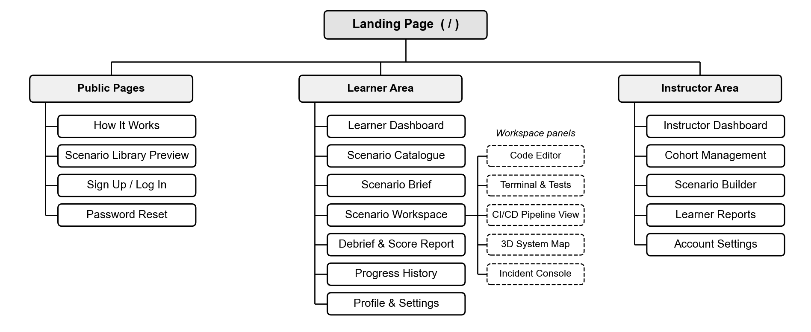

# Prodlike — Assignment 1: Website Proposal and SRS

> Converted from `Prodlike - Website Proposal & SRS.docx` (CS344, submitted before the build). This is the source of truth for FR-01..FR-20 and NFR-01..NFR-14.

National University of Sciences and Technology (NUST)

School of Electrical Engineering and Computer Science (SEECS)

Assignment 1 – Website Proposal

Prodlike: A Practical Software Engineering Training Simulator

| Course         | 344 – Web Engineering                                                                                                                                                                |
| -------------- | ------------------------------------------------------------------------------------------------------------------------------------------------------------------------------------ |
| Instructor     | Ms. Naema Asif                                                                                                                                                                       |
| Assignment     | Assignment No. 1 – Website Proposal (Group Assignment)                                                                                                                               |
| CLOs Addressed | CLO 2 – Understand the fundamental concepts, protocols, and architectures that support web-based solutions. CLO 5 – Perform effectively both individually and as a member of a team. |
| Team Name      | Team Prodlike                                                                                                                                                                        |
| Team Lead      | Najiah Khalid                                                                                                                                                                        |

| #   | Group Member              | Registration No. | Primary Responsibility                            |
| --- | ------------------------- | ---------------- | ------------------------------------------------- |
| 1   | Najiah Khalid (Team Lead) | 480784           | Backend tier, sandbox runner & scoring engine     |
| 2   | Zeeshan Haider Awan       | 503860           | Frontend tier & 3D system map                     |
| 3   | Bilal Ahmed               | 501603           | Database tier, scenario content, testing & DevOps |

## Part A – Website Proposal

### 1. Purpose of the Website

Main purpose. Prodlike is a web platform where computer science students and junior developers practise the real responsibilities of a software engineer inside a safe, production-like simulation. A trainee receives an existing application and a ticket, understands the codebase, fixes a bug or adds a feature, writes and runs tests, ships the change through a CI/CD pipeline and then handles whatever goes wrong next, such as a failed deployment or a spike in errors that must be investigated and rolled back.

Problem it solves. University courses and popular coding sites mostly check whether code compiles or whether an algorithm puzzle is solved. Industry, however, expects engineering judgment: reading code someone else wrote, choosing what to test, deploying safely and staying calm during an incident. Most graduates meet these situations for the first time on the job, where a mistake affects real users. Our own team is an example: we have written plenty of code, but none of us has ever deployed to a live system or rolled back a broken release.

Value and need. Prodlike gives learners repeated, scored practice and a debrief that explains what a senior engineer would have done differently. Instructors get ready-made practical exercises that are graded automatically, and engineering teams get a low-cost onboarding drill. Because every environment is simulated and disposable, learners can fail, learn and retry without risking anything real.

### 2. Goals & Objectives

- Deliver a working MVP with at least four end-to-end scenarios (bug fix, feature change, failed deployment with rollback, and a configuration incident) by the end of the semester.
- Run every learner’s code and tests in an isolated, disposable sandbox so that no attempt can affect another user or the host server.
- Score every attempt automatically against transparent, objective-based rubrics covering correctness, testing, deployment safety and recovery, while accepting any valid solution.
- Make system behaviour visible through a live 3D system map that shows deployments, failures and recoveries in real time.
- Give instructors a dashboard to assign scenarios to cohorts and track each learner’s progress across multiple attempts.

### 3. Target Audience

| Attribute               | Primary: Students & Junior Developers                                                                   | Secondary: Instructors & Trainers                                           | Tertiary: Engineering Team Leads                        |
| ----------------------- | ------------------------------------------------------------------------------------------------------- | --------------------------------------------------------------------------- | ------------------------------------------------------- |
| Age Group               | 19 – 26                                                                                                 | 28 – 55                                                                     | 25 – 45                                                 |
| Profession / Background | CS/SE undergraduates, bootcamp graduates, interns, developers with 0–2 years of experience              | University lecturers, lab engineers, teaching assistants, bootcamp trainers | Tech leads and managers who onboard or assess new hires |
| Location                | Local first (NUST and other Pakistani universities); web-based, so national and international by design | Local and national                                                          | National and international                              |
| Technical Skills        | Average: comfortable writing code, new to Git workflows, CI/CD and production                           | Average to advanced                                                         | Advanced                                                |
| Interests / Needs       | Job readiness, proof of practical skill for interviews, a safe place to fail                            | Practical labs that are auto-graded and hard to copy                        | A repeatable way to train and evaluate juniors          |
| Why They Visit          | Attempt scenarios, retry to beat their score, review debriefs                                           | Assign scenarios, review cohort results, author scenarios                   | Run onboarding drills and compare results               |
| Visit Frequency         | 2–3 sessions per week during a course; daily before interviews                                          | Weekly during a lab cycle                                                   | Once per hiring or onboarding cycle                     |

### 4. Information to be Collected / Provided

| Information the Website Provides                                                                                                                                                                                                                                                                                                                                                                                                                     | Information Collected from Users                                                                                                                                                                                                                                                                                                                                                                                          |
| ---------------------------------------------------------------------------------------------------------------------------------------------------------------------------------------------------------------------------------------------------------------------------------------------------------------------------------------------------------------------------------------------------------------------------------------------------- | ------------------------------------------------------------------------------------------------------------------------------------------------------------------------------------------------------------------------------------------------------------------------------------------------------------------------------------------------------------------------------------------------------------------------- |
| Scenario briefs: ticket-style tasks set in a fictional company, with objectives and constraints. / Scenario codebases: small realistic applications with README files, logs and commit history. / System signals: simulated logs, metrics, alerts and pipeline output. / Debrief reports: rubric score breakdown, timeline highlights and model-answer explanations. / Concept notes: short guides on rollbacks, health checks, canary deploys, etc. | Account data: name, email, university or organisation and role (passwords stored only as salted hashes). / Attempt data: code changes, test runs, terminal commands, pipeline and deployment actions, with timestamps. / Assessment results: score per rubric objective and time to recover. / Instructor data: cohorts, assignments, deadlines and custom scenarios. / Optional feedback: scenario ratings and comments. |

Usefulness to both sides. For learners, the recorded action timeline lets the debrief point to the exact decision that helped or hurt, and attempt history shows measurable improvement. For instructors it replaces manual grading with objective evidence. For our team, aggregated and anonymised attempt data shows which scenarios are too hard, which checks are unfair and where learners commonly fail, which directly guides content updates. Only the data needed is collected, it is never sold, and instructors can see only their own cohorts.

### 5. Content Strategy

Content formats.

- Interactive scenarios (core content): brief → code editor → tests → pipeline → deployment → incident → debrief.
- Code and documentation: realistic mini-applications such as a food-delivery API or a clinic booking system.
- Live visuals: the 3D system map, a pipeline stage view and metric charts (error rate, latency).
- Text and media: concept notes, onboarding tooltips and short walkthrough videos on the How It Works page.
- Feedback content: score reports, rubric breakdowns and “what a senior engineer would do” explanations.

Keeping it engaging and up to date.

- Story-driven tasks: each scenario has a fictional company, a message from a teammate and an incident that escalates on a timer.
- Progression: difficulty tiers, skill badges (e.g. “Clean Rollback”) and personal-best tracking motivate repeat attempts.
- Randomised variants: the same scenario injects different faults on each attempt, so answers cannot simply be shared.
- Scenarios as data: each scenario is a versioned definition file plus a code template, so new content is added without changing platform code, including by instructors through the Scenario Builder.
- Regular review: scenario difficulty and rubrics are reviewed every two weeks using attempt analytics, and sandbox images are updated each term.

### 6. Competitor / Similar Websites

| Website               | Strengths                                                                       | Weaknesses                                                                                                     | How Prodlike is Different                                                |
| --------------------- | ------------------------------------------------------------------------------- | -------------------------------------------------------------------------------------------------------------- | ------------------------------------------------------------------------ |
| LeetCode / HackerRank | Huge problem banks, instant auto-grading, widely recognised by recruiters       | Isolated algorithm puzzles; no existing codebase, testing strategy, deployment or incidents                    | Tests the full engineering workflow, not only problem-solving            |
| SadServers            | Real broken Linux servers to fix under time pressure; realistic troubleshooting | Linux administration only; no code changes, tests or CI/CD; no instructor tools                                | Combines coding, testing and shipping with incident response             |
| Killercoda / Instruqt | Real browser-based sandboxes for DevOps tools such as Docker and Kubernetes     | Mostly step-by-step tutorials that say what to type; little open-ended judgment; Instruqt is enterprise-priced | Open-ended tasks where many solutions are valid and decisions are scored |
| GitHub Skills         | Free, uses real repositories and GitHub Actions; good introduction to workflows | Linear checklist courses; no failure injection, recovery practice or detailed assessment                       | Injects failures, measures recovery and gives a scored debrief           |

Our edge. Prodlike is the only option in this group that joins the whole lifecycle (understand, change, test, ship, recover) into one scored story. It assesses judgment as well as output (which tests were added, whether deployment was staged, how quickly service was restored), accepts multiple valid solutions, makes system state visible through a 3D map, and includes cohort tools so a university can run it as a lab.

### 7. Success Criteria

| Metric                   | Target (End-of-Semester Pilot)                                                         |
| ------------------------ | -------------------------------------------------------------------------------------- |
| Scenario completion rate | At least 70% of started attempts reach a scored debrief                                |
| Learning gain            | Average score on a learner’s third attempt is at least 25% higher than on the first    |
| Recovery skill           | Median time-to-recover in the rollback scenario falls across repeated attempts         |
| Usability                | System Usability Scale (SUS) score of 70 or more from a pilot group of 15+ students    |
| Reliability              | Sandbox starts successfully in 95%+ of attempts, in under 10 seconds                   |
| Instructor adoption      | At least one instructor or TA creates a cohort and assigns a scenario during the pilot |

### 8. Group Coordination & Task Delegation

Communication and coordination. A WhatsApp group is used for daily quick updates, and a fixed 30-minute weekly sync is held in person at SEECS or on Google Meet. All work is tracked on a GitHub Projects Kanban board, bugs are filed as GitHub Issues, documents live in a shared Google Drive, and key decisions are recorded in meeting notes.

| Member                    | Primary Ownership                                                                                                                                                  | Review Responsibility             |
| ------------------------- | ------------------------------------------------------------------------------------------------------------------------------------------------------------------ | --------------------------------- |
| Najiah Khalid (Team Lead) | Backend tier: NestJS REST API and WebSocket gateway, authentication and roles, Docker sandbox runner, scenario engine and scoring; sprint planning and integration | Database schema and migrations    |
| Zeeshan Haider Awan       | Frontend tier: Next.js pages, scenario workspace (code editor, terminal, pipeline view), 3D system map in React Three Fiber, responsive design                     | API contracts and endpoint design |
| Bilal Ahmed               | Database tier and quality: PostgreSQL schema with Prisma, seed scenarios and code templates, automated tests, CI pipeline and deployment of Prodlike itself        | Frontend accessibility and UX     |
| All members               | Requirements, scenario writing, documentation, pilot testing and final presentation                                                                                | —                                 |

Fair participation and accountability.

- Every task is a GitHub issue with one owner and a due date; work outside the board is not counted.
- Each feature is built on its own branch and merged by pull request after approval from a different member. Cross-review spreads knowledge and removes single points of failure.
- Commit history and the board give a transparent record of each member’s contribution, reviewed at every weekly sync.
- Work runs in two-week sprints, each ending with a short internal demo; slipped tasks are re-planned openly.
- Disagreements are discussed at the sync. If they remain unresolved, the team lead decides after hearing both sides and the decision is logged.

Development timeline (8 weeks).

| Weeks | Milestone                                                                                                             |
| ----- | --------------------------------------------------------------------------------------------------------------------- |
| 1 – 2 | Finalise requirements and UI wireframes; set up repository, CI and database schema; build the first scenario codebase |
| 3 – 4 | Authentication and roles, scenario catalogue, code editor and terminal, Docker sandbox runner                         |
| 5 – 6 | Scenario engine (pipeline, deployment, incident injection), scoring and debrief, 3D system map                        |
| 7 – 8 | Instructor dashboard and cohorts, remaining scenarios, testing, pilot with classmates, final report                   |

## Part B – Software Requirements Specification (SRS)

Prodlike, version 1.0 (MVP) | Prepared by Team Prodlike for 344 – Web Engineering, NUST SEECS

### 1. Introduction

1.1 Purpose of the System. This SRS defines the functional and non-functional requirements of Prodlike 1.0, the minimum viable product to be built during the semester. It is written for the development team and the course instructor and serves as the baseline for design, implementation and testing. Prodlike exists to let learners practise the end-to-end responsibilities of a software engineer in a safe, simulated production environment and to assess them objectively.

1.2 Scope of the System. Prodlike uses a hybrid simulation: learners’ code changes and tests run for real inside short-lived Docker containers, while the CI/CD pipeline, deployment and production incidents are simulated by a scenario engine that produces realistic logs, metrics and alerts. This keeps the experience authentic while staying achievable within one semester.

| In Scope (Version 1.0)                                                                                                                                                                                                                                                                                                                                                                                                        | Out of Scope (Future Work)                                                                                                                                                                                                                                                          |
| ----------------------------------------------------------------------------------------------------------------------------------------------------------------------------------------------------------------------------------------------------------------------------------------------------------------------------------------------------------------------------------------------------------------------------- | ----------------------------------------------------------------------------------------------------------------------------------------------------------------------------------------------------------------------------------------------------------------------------------- |
| User accounts with Learner, Instructor and Admin roles / Scenario catalogue with at least four scenarios / Browser workspace: code editor, terminal and test runner backed by an isolated container / Simulated CI/CD pipeline, deployment and injected incidents / Live 3D system map / Rubric-based automatic scoring, debrief and progress history / Instructor cohorts, assignments, reports and a basic Scenario Builder | Real deployment to external cloud providers / Real-time multi-learner team exercises / Scenario codebases in languages other than JavaScript/TypeScript / Payments, subscriptions and a mobile app / AI-generated scenarios or AI hints / Integration with university LMS platforms |

1.3 Definitions, Acronyms and Abbreviations.

| Term     | Meaning                                                                                  | Term      | Meaning                                                                       |
| -------- | ---------------------------------------------------------------------------------------- | --------- | ----------------------------------------------------------------------------- |
| CI/CD    | Continuous Integration / Continuous Delivery: automated build, test and release pipeline | Scenario  | A packaged exercise: brief, code template, injected faults and scoring rubric |
| Sandbox  | An isolated, disposable Docker container in which a learner’s code runs                  | Incident  | A simulated production failure the learner must investigate and resolve       |
| Rollback | Restoring the last known good release after a failed deployment                          | Rubric    | The set of weighted checks used to score an attempt                           |
| MTTR     | Mean Time To Recover: time from incident alert to restored service                       | RBAC      | Role-Based Access Control                                                     |
| ORM      | Object-Relational Mapper (Prisma in this project)                                        | JWT       | JSON Web Token, used for authenticated sessions                               |
| R3F      | React Three Fiber, a React renderer for Three.js 3D graphics                             | MVP / SRS | Minimum Viable Product / Software Requirements Specification                  |

### 2. Overall Description

2.1 Product Perspective (Three-Tier Architecture). Prodlike is a new, self-contained web application organised into three tiers:

| Tier                    | Technology                                                                                       | Responsibility                                                                                                                                       |
| ----------------------- | ------------------------------------------------------------------------------------------------ | ---------------------------------------------------------------------------------------------------------------------------------------------------- |
| Presentation (Frontend) | Next.js (React, TypeScript), Tailwind CSS, Monaco Editor, xterm.js, React Three Fiber / Three.js | All pages and the scenario workspace; renders the 3D system map; talks to the backend over HTTPS (REST) and receives live events over WebSockets     |
| Application (Backend)   | NestJS (Node.js, TypeScript), Docker Engine API, WebSocket gateway                               | Authentication and RBAC, business logic, creating and destroying sandboxes, scenario engine state machine (pipeline, deployment, incidents), scoring |
| Data (Database)         | PostgreSQL accessed through the Prisma ORM                                                       | Persistent storage of users, cohorts, scenarios, attempts, action events and scores                                                                  |

2.2 User Needs and Characteristics.

| User Class    | Characteristics                                                                                                                 | Key Needs                                                                                      |
| ------------- | ------------------------------------------------------------------------------------------------------------------------------- | ---------------------------------------------------------------------------------------------- |
| Learner       | Student or junior developer; can program in JavaScript but has limited experience of Git, testing, CI/CD and production systems | Clear briefs, a responsive workspace, fair scoring, explanations of mistakes, visible progress |
| Instructor    | Lecturer, TA or trainer; technically skilled but short on time for manual grading                                               | Assign scenarios to cohorts, view results quickly, export grades, create scenario variants     |
| Administrator | Member of the Prodlike team who maintains the platform                                                                          | Manage users and roles, publish scenarios, monitor sandbox health                              |

2.3 Assumptions and Dependencies.

- Users have a modern desktop browser (Chrome, Edge or Firefox) with WebGL support and a stable connection of at least 5 Mbps.
- A host server with Docker Engine is available: team laptops during development and a single cloud VM (about 8 vCPU / 16 GB RAM) for the demonstration.
- Scenario codebases are small Node.js applications (under about 2,000 lines) so that test runs finish within seconds.
- The pipeline and deployment are simulated; no change is deployed to a real external environment.
- The system depends on open-source software: Next.js, NestJS, Prisma, PostgreSQL, Docker, Monaco Editor, xterm.js and Three.js.

### 3. Functional Requirements

Priorities use MoSCoW: M = Must have, S = Should have, C = Could have.

| ID    | Module     | Requirement: The system shall…                                                                                                                               | Priority |
| ----- | ---------- | ------------------------------------------------------------------------------------------------------------------------------------------------------------ | -------- |
| FR-01 | Accounts   | allow users to register, log in, log out and reset a forgotten password using email and password.                                                            | M        |
| FR-02 | Accounts   | enforce role-based access for Learner, Instructor and Admin roles on every page and API endpoint.                                                            | M        |
| FR-03 | Catalogue  | list scenarios with title, difficulty, estimated time and skills covered, with filtering by difficulty and skill.                                            | M        |
| FR-04 | Catalogue  | show a scenario brief (ticket, company context, objectives, constraints) before an attempt begins.                                                           | M        |
| FR-05 | Workspace  | provision an isolated sandbox with the scenario codebase when an attempt starts, and destroy it when the attempt ends or after 60 minutes of inactivity.     | M        |
| FR-06 | Workspace  | provide a browser code editor with a file tree and a terminal restricted to permitted commands (e.g. running tests, viewing diffs and logs).                 | M        |
| FR-07 | Workspace  | run the scenario’s test suite and any tests the learner writes, and display the results.                                                                     | M        |
| FR-08 | Pipeline   | let the learner commit changes and trigger a simulated CI/CD pipeline (build, lint, test, deploy) with stage-by-stage logs; failing stages block deployment. | M        |
| FR-09 | Pipeline   | offer deployment strategies (direct or canary) and a post-deployment health check.                                                                           | S        |
| FR-10 | Incidents  | inject scripted failures (failed deployment, error spike, bad configuration) at defined trigger points and raise alerts in the Incident Console.             | M        |
| FR-11 | Incidents  | let the learner investigate using logs and metrics and recover by rollback, hotfix redeployment or configuration change.                                     | M        |
| FR-12 | 3D Map     | render a live 3D map of the scenario’s architecture whose components change state (healthy, deploying, degraded, down) in real time.                         | M        |
| FR-13 | Assessment | record every significant learner action with a timestamp in an attempt timeline.                                                                             | M        |
| FR-14 | Assessment | score each attempt against rubric checks for correctness, testing, deployment safety and recovery, accepting any solution that satisfies the checks.         | M        |
| FR-15 | Assessment | generate a debrief with the score breakdown, key timeline moments and recommended next scenarios.                                                            | M        |
| FR-16 | Progress   | store all attempts and show each learner’s score history and per-skill trends.                                                                               | M        |
| FR-17 | Instructor | allow instructors to create cohorts, enrol learners with a join code and assign scenarios with deadlines.                                                    | S        |
| FR-18 | Instructor | show per-learner and cohort-level results and allow export as CSV.                                                                                           | S        |
| FR-19 | Instructor | provide a Scenario Builder for creating scenario variants (brief, faults to inject, rubric weights).                                                         | C        |
| FR-20 | Admin      | allow administrators to manage users and roles and to publish or unpublish scenarios.                                                                        | S        |

### 4. Non-Functional Requirements

| ID     | Category    | Requirement                                                                                                                                                     |
| ------ | ----------- | --------------------------------------------------------------------------------------------------------------------------------------------------------------- |
| NFR-01 | Performance | Pages shall reach Largest Contentful Paint within 2.5 seconds on a 10 Mbps connection.                                                                          |
| NFR-02 | Performance | A sandbox shall be ready within 10 seconds of starting an attempt, and a scenario test run shall complete within 30 seconds.                                    |
| NFR-03 | Performance | Engine events (deployment progress, incidents) shall reach the browser and update the 3D map within 1 second.                                                   |
| NFR-04 | Performance | The MVP shall support at least 20 concurrent active sandboxes on the demonstration server.                                                                      |
| NFR-05 | Performance | The 3D map shall run at 30+ FPS on a typical student laptop and fall back to a 2D diagram if WebGL is unavailable.                                              |
| NFR-06 | Usability   | A first-time learner shall be able to start a scenario within 3 minutes of signing up, guided by an onboarding tour.                                            |
| NFR-07 | Usability   | The interface shall meet WCAG 2.1 AA contrast and keyboard-navigation guidelines; system status shall never rely on colour alone.                               |
| NFR-08 | Usability   | The layout shall be responsive from desktop (1280 px) to tablet (768 px); dashboards shall remain readable on mobile.                                           |
| NFR-09 | Usability   | Error messages shall state what happened and what the user can do next.                                                                                         |
| NFR-10 | Security    | Sandboxes shall run as non-root users with CPU, memory and time limits and no access to the host, the internet or other sandboxes.                              |
| NFR-11 | Security    | Passwords shall be hashed with bcrypt; sessions shall use short-lived JWTs stored in HTTP-only, secure cookies.                                                 |
| NFR-12 | Security    | All traffic shall use HTTPS; all input shall be validated on the server, and database access shall use parameterised queries (Prisma) to prevent SQL injection. |
| NFR-13 | Security    | Instructors shall only access data belonging to their own cohorts; login and sandbox creation shall be rate-limited.                                            |
| NFR-14 | Reliability | Attempt progress shall be saved every 30 seconds so a refresh or disconnection resumes the attempt.                                                             |

### 5. Preliminary Sitemap

Figure 1: Preliminary sitemap of Prodlike. Dashed boxes are panels inside the Scenario Workspace page.

All Learner and Instructor pages require login and are protected by role-based access (FR-02). The Scenario Workspace is the core page of the system; its five panels share one live connection to the scenario engine so that every action is reflected in the 3D map and timeline immediately.

## Figure 1: Preliminary sitemap

